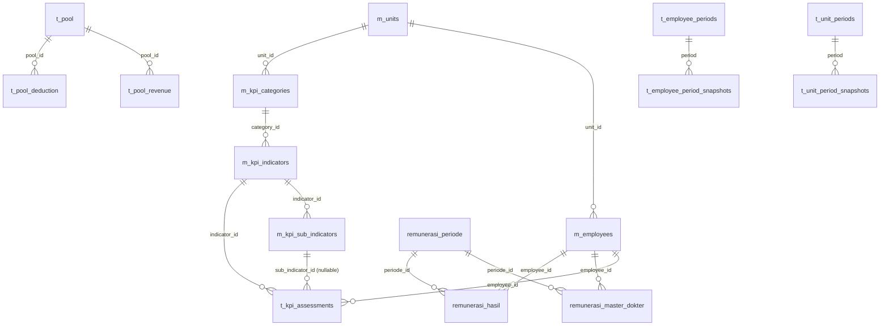

# Skema Database Lengkap — PINTAR JP (JASPEL Enterprise)

Dokumen ini mendokumentasikan seluruh **20 tabel produksi** di PostgreSQL (Supabase), beserta fungsi kolom, relasi kunci, aturan period locking/snapshot, dan index kritis yang wajib ada agar aplikasi hasil replikasi bekerja 100% identik.

---

## 1. Diagram Relasi Entitas Utama (ERD)

---

## 2. Tabel Master (`m_*`)

### 2.1 `m_units` (Master Unit Kerja)
Menyimpan daftar unit kerja beserta proporsi alokasi dana dan mode skema KPI.
- **Kolom**:
  - `id` (UUID, PK)
  - `code` (TEXT, UNIQUE) — Kode unit. Nilai `ADMIN` / `SUPERADMIN` dikecualikan dari kalkulasi KPI & insentif.
  - `name` (TEXT) — Nama unit. Nama `MEDIS` / diawali `MEDIS ` otomatis memicu mode kalkulasi Medis (SUM).
  - `proportion_percentage` (NUMERIC) — Persentase proporsi unit untuk pendapatan **BPJS** (0–100%).
  - `proportion_umum_percentage` (NUMERIC) — Persentase proporsi unit untuk pendapatan **UMUM** (0–100%).
  - `use_same_proportion` (BOOLEAN, default `true`) — Jika `true`, proporsi UMUM mengikuti `proportion_percentage` BPJS.
  - `remuneration_style` (TEXT) — Gaya remunerasi unit (mis. `standard`, `medical`).
  - `kpi_schema_mode` (TEXT) — `'same'` (indikator BPJS & UMUM sama, mendukung fallback silang) atau `'different'` (indikator BPJS & UMUM terpisah ketat).
  - `is_active` (BOOLEAN, default `true`)
  - `created_at`, `updated_at` (TIMESTAMPTZ)

### 2.2 `m_employees` (Master Pegawai)
Menyimpan seluruh pegawai dan pemetaan akun Supabase Auth (`user_id`).
- **Kolom**:
  - `id` (UUID, PK)
  - `user_id` (UUID, nullable, relasi ke `auth.users.id`)
  - `employee_code` (TEXT) — NIP / Kode Pegawai
  - `full_name` (TEXT)
  - `unit_id` (UUID, FK → `m_units.id`)
  - `role` (TEXT) — `'superadmin' | 'unit_manager' | 'employee'`
  - `email`, `phone`, `nik`, `position` (TEXT)
  - `bank_name`, `bank_account_number`, `bank_account_name` (TEXT) — Data transfer slip insentif
  - `tax_status` (TEXT) — Status PTKP: `'TK/0'`, `'TK/1'`, `'TK/2'`, `'TK/3'`, `'K/0'`, `'K/1'`, `'K/2'`, `'K/3'`
  - `tax_type` (TEXT) — `'TER'` / `'Final'` / `'gross'`
  - `employment_status` (TEXT) — `'ASN'`, `'PNS'`, `'PPPK'`, `'BLUD'`, dll.
  - `employee_status` (TEXT) — Legacy status (`'active'`, `'ASN'`, dll.)
  - `pns_grade` (TEXT) — Golongan PNS (`'I/a'`..`'IV/e'`), digunakan oleh mekanisme pajak Final PP 80/2010
  - `is_contract` (BOOLEAN, default `false`) — Status kontrak (Medis) / sebagian (Keperawatan, Radiologi, Rekam Medik)
  - `contract_percentage` (NUMERIC, default `100`) — Persentase pengali indeks (0–100%)
  - `is_active` (BOOLEAN, default `true`)
  - `created_at`, `updated_at` (TIMESTAMPTZ)

### 2.3 `m_kpi_categories` (Kategori KPI P1, P2, P3)
- **Kolom**:
  - `id` (UUID, PK)
  - `unit_id` (UUID, FK → `m_units.id`)
  - `category` (TEXT) — `'P1'`, `'P2'`, atau `'P3'`
  - `category_name` (TEXT) — Label deskriptif (mis. `Posisi`, `Kinerja`, `Potensi`)
  - `weight_percentage` (NUMERIC) — Bobot kategori (total P1+P2+P3 = 100% untuk unit standar)
  - `description` (TEXT)
  - `configuration_style` (TEXT) — `'standard'` atau `'activity'`
  - `is_weighted` (BOOLEAN, default `true`) — Menentukan apakah kategori menggunakan pembobotan
  - `revenue_type` (TEXT) — `'bpjs'`, `'umum'`, atau `'all'` (digunakan saat `m_units.kpi_schema_mode = 'different'`)
  - `is_active` (BOOLEAN, default `true`)
  - `created_at`, `updated_at` (TIMESTAMPTZ)

### 2.4 `m_kpi_indicators` (Indikator KPI)
- **Kolom**:
  - `id` (UUID, PK)
  - `category_id` (UUID, FK → `m_kpi_categories.id`)
  - `code` (TEXT), `name` (TEXT)
  - `target_value` (NUMERIC) — Target indikator (untuk kualitatif sering bernilai `0` atau `100`)
  - `weight_percentage` (NUMERIC) — Bobot indikator dalam kategori
  - `measurement_unit` (TEXT) — Satuan (mis. `Skor`, `Pasien`, `Tindakan`, `Rupiah`)
  - `measurement_type` (TEXT) — `'quantitative'` atau `'qualitative'`
  - `calculation_method` (TEXT) — **`'indexing'`** (masuk perhitungan skor indeks & PIR) atau **`'priority'`** (masuk Insentif Prioritas Rupiah langsung, atau Potongan jika nilainya negatif!)
  - `base_index_value` / `basic_index_value` / `unit_tariff` (NUMERIC) — Tarif / nilai dasar pengali (Rp atau poin per unit)
  - `service_types` (JSONB/TEXT)
  - `description` (TEXT), `is_active` (BOOLEAN)
  - `created_at`, `updated_at` (TIMESTAMPTZ)

### 2.5 `m_kpi_sub_indicators` (Sub-Indikator KPI)
- **Kolom**:
  - `id` (UUID, PK)
  - `indicator_id` (UUID, FK → `m_kpi_indicators.id`)
  - `code` (TEXT), `name` (TEXT)
  - `target_value` (NUMERIC), `weight_percentage` (NUMERIC)
  - `scoring_criteria` (JSONB) — Daftar pilihan kriteria penilaian kualitatif (mis. `{ label, score }[]`)
  - `measurement_unit` (TEXT)
  - `measurement_type` (TEXT) — `'quantitative'` (`realization_value * base_index_value`) atau `'qualitative'` (skor langsung / berbobot)
  - `unit_tariff`, `base_index_value` (NUMERIC)
  - `service_types`, `description`, `is_active`
  - `created_at`, `updated_at` (TIMESTAMPTZ)

---

## 3. Tabel Transaksi (`t_*`)

### 3.1 `t_pool`, `t_pool_revenue`, `t_pool_deduction` (Pool Insentif Bulanan)
- **`t_pool`**:
  - `id` (UUID, PK), `period` (TEXT, format `YYYY-MM`, mis. `2026-01`)
  - `revenue_bpjs`, `revenue_umum`, `revenue_total` (NUMERIC)
  - `allocation_percentage_bpjs`, `allocation_percentage_umum`, `global_allocation_percentage` (NUMERIC)
  - `allocated_bpjs`, `allocated_umum`, `allocated_amount` (NUMERIC)
  - `deduction_total`, `net_pool` (NUMERIC)
  - `status` (TEXT) — `'draft' | 'approved' | 'distributed'`. Status `'approved'` mengunci penilaian KPI pada periode tersebut!
  - `approved_by` (UUID), `approved_at`, `created_at`, `updated_at`
- **`t_pool_revenue`**:
  - `id`, `pool_id` (FK → `t_pool.id`), `revenue_code` (`'BPJS' | 'UMUM'`), `revenue_type` (`'BPJS Kesehatan' | 'Pendapatan Umum'`), `category` (`'Rawat Jalan' | 'Rawat Inap' | 'AMHP' | 'Ambulance'`), `description`, `amount`, `patient_count`, `created_at`
- **`t_pool_deduction`**:
  - `id`, `pool_id` (FK → `t_pool.id`), `description`, `amount`, `created_at`

### 3.2 `t_kpi_assessments` (Tabel Transaksi Utama Penilaian KPI)
Tabel terbesar di sistem (mendukung baris Indikator Utama dimana `sub_indicator_id IS NULL` dan baris Sub-Indikator dimana `sub_indicator_id IS NOT NULL`).
- **Kolom**:
  - `id` (UUID, PK)
  - `employee_id` (UUID, FK → `m_employees.id`)
  - `indicator_id` (UUID, FK → `m_kpi_indicators.id`)
  - `sub_indicator_id` (UUID, nullable, FK → `m_kpi_sub_indicators.id`)
  - `period` (TEXT, format `YYYY-MM`)
  - `revenue_type` (TEXT, default `'bpjs'`) — `'bpjs'` atau `'umum'`
  - `realization_value` (NUMERIC) — Nilai realisasi / volume / skor input
  - `target_value` (NUMERIC)
  - `weight_percentage` (NUMERIC)
  - `achievement_percentage` (NUMERIC)
  - `score` (NUMERIC) — Nilai skor hasil kalkulasi (bisa negatif untuk indikator potongan!)
  - `sub_assessments` (JSONB, nullable)
  - `is_contract` (BOOLEAN) — Status kontrak/sebagian per penilaian periode ini
  - `contract_percentage` (NUMERIC) — Persentase kontrak/sebagian (0–100)
  - `notes` (TEXT), `assessor_id` (UUID), `created_at`, `updated_at`
- **Index Kritis**:
  - Unique constraint/index pada `(employee_id, indicator_id, period, sub_indicator_id, revenue_type)` untuk mencegah duplikasi saat `upsert` / `bulk-copy`.
  - Index pada `(period, revenue_type)` dan `(employee_id, period)` untuk performa query.

### 3.3 Sistem Period Locking & Snapshot (Pegawai & Unit)
Memastikan perubahan mutasi pegawai atau perubahan proporsi unit di bulan berjalan **tidak mengubah hasil laporan bulan-bulan sebelumnya**:
- **`t_employee_periods`**: `id, period, period_name, is_locked, locked_at, locked_by, notes, created_at, updated_at`
- **`t_employee_period_snapshots`**: Menyimpan salinan beku seluruh kolom `m_employees` untuk `period` tertentu (`period, employee_id, employee_code, full_name, unit_id, position, role, employee_status, employment_status, pns_grade, tax_status, tax_type, nik, bank_name, bank_account_number, bank_account_name, phone, email, is_active, is_contract, contract_percentage`).
  - **Aturan**: Jika snapshot ada untuk `period` yang diminta (`count > 0`), seluruh API Penilaian (`/api/assessment/*`) dan Laporan (`/api/reports/generate`) **wajib membaca dari `t_employee_period_snapshots`** alih-alih `m_employees`!
- **`t_unit_periods`**: `id, period, period_name, is_locked, locked_at, locked_by, notes, created_at, updated_at`
- **`t_unit_period_snapshots`**: Menyimpan salinan beku proporsi unit untuk `period` tertentu (`period, unit_id, code, name, proportion_percentage, proportion_umum_percentage, use_same_proportion, remuneration_style, kpi_schema_mode, is_active`).
  - **Aturan**: Saat menghitung Alokasi Unit di `/api/reports/generate`, sistem mengecek `t_unit_period_snapshots` terlebih dahulu sebelum fallback ke `m_units`.

### 3.4 Tabel Pendukung & Remunerasi Dokter
- **`t_history_pir`**: Riwayat nilai PIR setiap unit per periode (`period, unit_id, unit_name, net_pool_amount, proportion_percentage, allocated_for_unit, total_skor_kolektif, pir_value, employee_count`).
- **`t_settings`**: Key-value JSONB pengaturan global (`company_info`, `footer`, `tax_config`, `tax_rates`, `ter_rates`, `calculation_params`, `session_timeout`).
  - Khusus `tax_config.value`: `{ "mechanism": "ter" | "final_pp80" | "none" }`.
- **`t_notification`**: Notifikasi user (`user_id, title, message, type, read, link, created_at, read_at`).
- **`t_audit_log`** / **`audit_logs`**: Jejak audit operasi CREATE/UPDATE/DELETE.
- **`remunerasi_periode`**: Periode remunerasi (`id, periode, total_pagu, status, description`). Status `'approved'` juga berfungsi mengunci periode penilaian.
- **`remunerasi_master_dokter`**: Pagu *Guarantee Fee* khusus dokter pada Unit Medis (`employee_id, periode_id, remun_kategori_id, pagu_guarantee_fee, index_id`).
- **`remunerasi_hasil`**: Penyimpanan hasil kalkulasi remunerasi dokter (`periode_id, employee_id, total_langsung, total_poin_indeks, konversi_indeks_rupiah, bruto, pajak_nominal, netto, pir_apply`).

