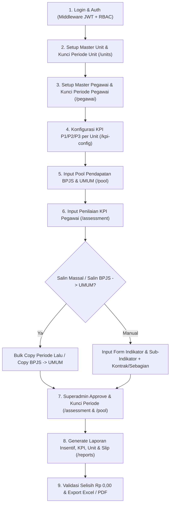

# Alur Bisnis End-to-End & Spesifikasi Tampilan UI — PINTAR JP

Dokumen ini menjelaskan **siklus alur kerja bulanan** dan **spesifikasi visual/komponen UI** pada setiap halaman sehingga aplikasi hasil replikasi memiliki alur dan tampilan yang identik.

---

## 1. Alur Operasional Bulanan (End-to-End Workflow)



### Urutan Kerja Wajib Setiap Bulan:
1. **Kunci Periode Unit (`/units`)**: Pastikan proporsi unit BPJS & UMUM (total 100%) benar, lalu buat/kunci snapshot periode di `t_unit_period_snapshots`.
2. **Kunci Periode Pegawai (`/pegawai`)**: Pastikan mutasi pegawai, PTKP, golongan PNS, rekening bank, dan status aktif sudah mutakhir, lalu buat/kunci snapshot di `t_employee_period_snapshots`.
3. **Konfigurasi KPI (`/kpi-config`)**: Pastikan bobot kategori P1/P2/P3 dan indikator aktif. Pilih mode `same` (skema BPJS & UMUM sama) atau `different` (skema terpisah).
4. **Buat Pool Insentif (`/pool`)**: Input rincian pendapatan BPJS & UMUM (`Rawat Jalan`, `Rawat Inap`, `AMHP`, `Ambulance`), persentase alokasi, dan potongan pool.
5. **Penilaian KPI (`/assessment`)**:
   - Pilih **Periode**, **Jenis Pendapatan (`BPJS` / `UMUM`)**, dan **Unit Kerja**.
   - Dapat menggunakan tombol **Salin dari Periode Sebelumnya** (bulk-copy per unit) atau **Salin BPJS → UMUM** (hanya menyalin indikator non-prioritas).
   - Klik tombol nilai per pegawai untuk mengisi realisasi indikator, sub-indikator, dan toggle status **Kontrak %** (Medis) atau **Sebagian %** (Keperawatan/Radiologi/Rekam Medik).
6. **Approval & Penguncian Periode**: Superadmin menekan tombol **Setujui & Kunci Periode** pada `/assessment` agar data penilaian tidak dapat diubah lagi.
7. **Generate & Export Laporan (`/reports`)**: Pilih jenis laporan, periode, unit/pegawai, dan jenis pendapatan (`BPJS` / `UMUM` / `Semua`) → klik **Buat Laporan** → Export ke **Excel (.xlsx)** atau **PDF**.

---

## 2. Design System & Token Tampilan (`app/globals.css` & `app/layout.tsx`)

### 2.1 Tipografi & Tema
- **Font Utama**: Google Font `Outfit` (`--font-outfit: 'Outfit', sans-serif`, `subsets: ['latin']`, antialiased).
- **Bahasa HTML**: `<html lang="id">`.
- **Toast Notification**: Sonner `<Toaster position="top-right" richColors />`.

### 2.2 Palet Warna & Utility Classes
- **Background Aplikasi**: `hsl(210 40% 98%)` (`bg-gray-50` / `from-gray-50 via-white to-gray-50`).
- **Primary**: `hsl(221.2 83.2% 53.3%)` (Royal Blue `#2563eb`).
- **Destructive**: `hsl(0 84.2% 60.2%)` (Red `#ef4444`).
- **Border Radius**: `--radius: 1rem` (rounded-xl / rounded-2xl modern cards).
- **Custom Utility Classes**:
  - `.premium-gradient`: `bg-gradient-to-br from-blue-600 via-blue-700 to-indigo-800` (Header Sidebar & tombol aktif).
  - `.glass`: `bg-white/70 backdrop-blur-xl border border-white/20`.
  - `.hover-scale`: `transition-transform duration-200 hover:scale-[1.02] active:scale-[0.98]`.
  - `.main-content`: Margin kiri dinamis `var(--sidebar-width)` (`272px` expanded, `80px` collapsed) pada `lg: ≥ 1024px`, dan `0` pada mobile dengan `pt-14` untuk tombol hamburger.

### 2.3 Struktur Layout Terproteksi (`app/(authenticated)/layout.tsx`)
```text
┌──────────────┬──────────────────────────────────────────────────┐
│              │  SessionActivityManager (modal idle 30 menit)    │
│   Sidebar    ├──────────────────────────────────────────────────┤
│  (272px /    │                                                  │
│   80px)      │              <main class="main-content">         │
│              │                <ErrorBoundary>{children}         │
│  - Logo/App  │                                                  │
│  - Nav Menu  ├──────────────────────────────────────────────────┤
│  - User Card │  <Footer /> (teks dari t_settings.footer)        │
└──────────────┴──────────────────────────────────────────────────┘
```

---

## 3. Spesifikasi Tampilan per Modul

### 3.1 Sidebar (`components/navigation/Sidebar.tsx`)
- **Header**: `.premium-gradient`, kotak logo putih `56x56px` (`rounded-2xl`), judul aplikasi bold warna oranye `#f97316` (`19px`, default `PINTAR JP`), subjudul nama RS (`10px`), tombol collapse (`ChevronLeft`/`ChevronRight`).
- **Menu Navigasi**: Menggunakan `OptimizedLink` (`prefetch={false}`). Item aktif menggunakan `.premium-gradient text-white shadow-lg`. Item `Notifikasi` menampilkan badge merah bundar jika `unreadCount > 0`.
- **Footer Sidebar**: Kartu profil pegawai (inisial avatar + indikator hijau online + nama + nama unit + badge role: `Superadmin` ungu / `Manajer Unit` biru / `Pegawai` abu) + tombol Logout dengan konfirmasi inline.

### 3.2 Dashboard (`/dashboard` — `DashboardContent.tsx`)
- **Header**: Judul `Dashboard`, sapaan `Selamat datang, [Nama] • [Unit]`.
- **Filter Bar (`DashboardFilters`)**: Dropdown Unit (khusus Superadmin), Dropdown Periode (`M-01`..`M-12`, `Q-1`..`Q-4`, `S-1`, `S-2`, `full-year`), Tahun, dan tombol Export.
- **4 StatCard (Superadmin) / 3 StatCard (Unit Manager)**: Total Pegawai, Total Unit, Rata-rata Skor (2 desimal), Tingkat Penyelesaian (%).
- **Grafik (Lazy-loaded Recharts)**:
  - `PerformanceChart` (Bar chart tren 6 bulan: P1, P2, P3, Total)
  - `KPIDistributionChart` (Distribusi P1 `#3b82f6`, P2 `#10b981`, P3 `#f59e0b`)
- **Tabel & Peringkat**: `UnitPerformanceTable` (2/3 lebar), `TopPerformers` & `WorstPerformers` (1/3 lebar), diikuti `QuickActions`.

### 3.3 Penilaian KPI (`/assessment` — `AssessmentPageContent.tsx`)
- **Tab Pendapatan**: `BPJS` dan `UMUM`.
- **Toolbar**: Filter Periode (dengan tombol tambah periode), Filter Unit, Search Pegawai (debounce 300ms), Filter Status (`Semua`, `Selesai`, `Sebagian`, `Belum Dinilai`), tombol **Salin Periode Lalu**, tombol **Salin BPJS → UMUM**, dan tombol **Setujui/Buka Kunci Periode** (Superadmin).
- **Kartu Ringkasan**: Total Pegawai, Selesai, Sebagian, Belum Dinilai, Progress Bar Persentase Penyelesaian.
- **Dialog Penilaian (`AssessmentFormDialog`)**: Menampilkan kategori P1/P2/P3 beserta indikator & sub-indikatornya, input nilai realisasi / pilihan kriteria skor kualitatif, kalkulasi skor real-time, toggle Kontrak/Sebagian %, dan tombol **Ambil dari Periode Lalu**.

### 3.4 Laporan (`/reports` — `app/(authenticated)/reports/page.tsx`)
- **4 Kartu Jenis Laporan**:
  1. `Laporan Insentif` (Biru)
  2. `Laporan Pencapaian KPI` (Hijau)
  3. `Laporan Perbandingan Unit` (Ungu)
  4. `Slip Pegawai` (Oranye)
- **Banner Validasi Alokasi Unit** (muncul saat filter 1 unit): Menampilkan `Alokasi Unit`, `Total Insentif Bruto`, dan badge hijau `✓ Insentif Bruto Sama Persis dengan Alokasi Unit (Selisih: Rp 0,00)`.
- **15 Kolom Tabel Laporan Insentif**:
  `NIP/NIK` | `NAMA PEGAWAI` | `UNIT` | `PROPORSI UNIT` | `P1` | `P2` | `P3` | `TOTAL INDEKS` | `INSENTIF PRIORITAS` | `PIR` | `POTONGAN` | `DISTRIBUSI POTONGAN` | `INSENTIF BRUTO` | `PAJAK` | `NETTO`
  *(Dilengkapi baris `TOTAL` di bagian bawah tabel dan sub-label ungu `(Prioritas: ...)` pada kolom P1/P2/P3 jika ada).*
- **Aksi Export**: Dropdown Export ke **Excel (.xlsx)**, **PDF (Cetak/Unduh)**, serta tombol **Unduh Petunjuk Penilaian KPI (PDF)**.

### 3.5 Pool Insentif (`/pool`), Unit (`/units`), Pegawai (`/pegawai`), KPI Config (`/kpi-config`), Pengaturan (`/settings`)
- **Pool**: Dialog 3 tab (`BPJS`, `UMUM`, `Potongan`), kalkulasi real-time `Net Pool` & `Alokasi`, grafik komposisi pendapatan (`PoolCharts`), dan cetak **PDF Overview Pool**.
- **Unit & Pegawai**: Pagination server-side, pencarian, filter unit, tombol **Import/Export Excel + Unduh Template**, serta banner & tombol **Kunci/Buka Periode** untuk manajemen snapshot bulanan.
- **KPI Config**: Tampilan hierarki tree (`KPITree`: Kategori → Indikator → Sub-Indikator), toggle mode skema (`Sama` vs `Berbeda` BPJS/UMUM), dialog **Salin Struktur Antar Unit** & **Salin Struktur BPJS → UMUM**, serta export panduan KPI.
- **Pengaturan**: Form Informasi Instansi (Nama Aplikasi, Nama RS, Alamat, Logo), Teks Footer, Pemilihan **Mekanisme Pajak Global** (`TER PP 58/2023`, `Final PP 80/2010`, `Tanpa Potongan`), dan Timeout Sesi.

